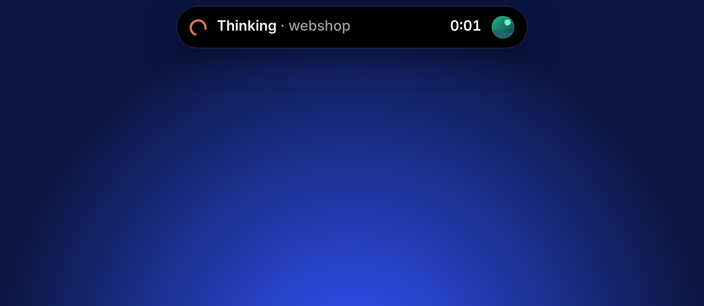
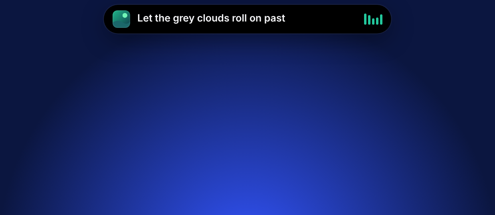
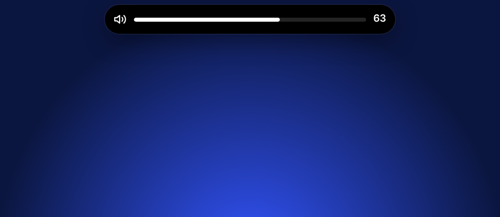
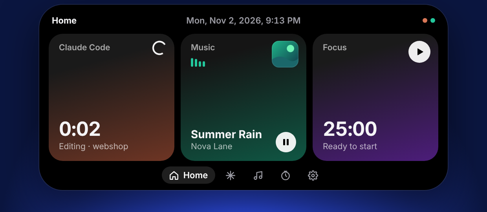
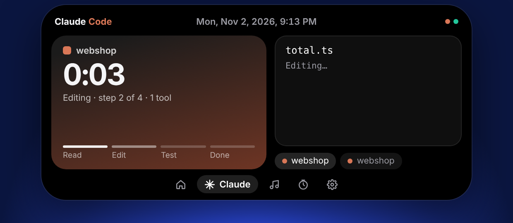
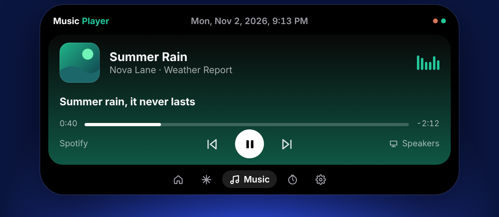
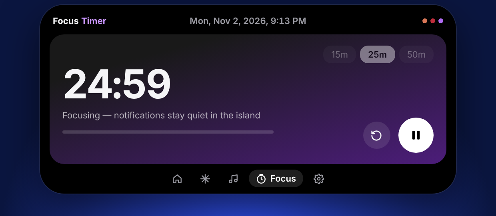
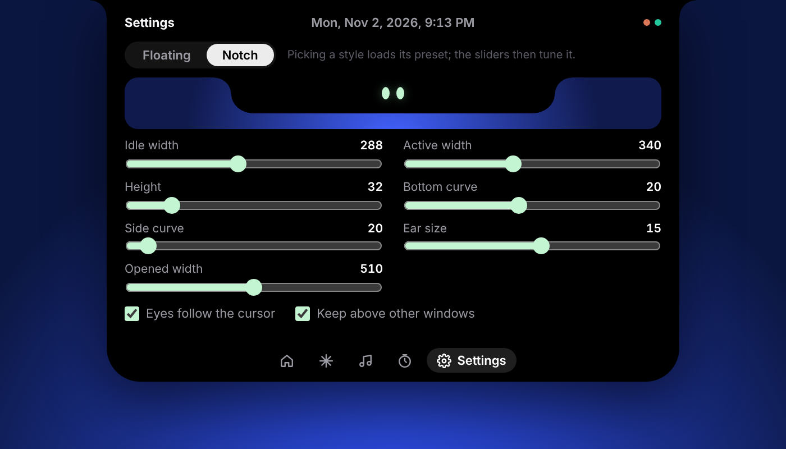

# Island

A Dynamic Island for Windows. A small black pill sits at the top of your screen and opens on hover.

- **Claude Code, live.** Shows every running session: project, elapsed time, the command being run, and Read → Edit → Test → Done progress. **Done stays blue until you look**, and it turns amber when Claude needs your permission.
- **Music that sets the colour.** Shows whatever is playing in Spotify (or any app that uses Windows media controls). The island takes its accent colour from the album art. Includes play/pause, skip and seek.
- **Lyrics in the island.** Synced lyrics from [LRCLIB](https://lrclib.net) scroll in the pill while you work.
- **Volume, right where you look.** A volume bar slides in whenever you change the system volume.
- **Focus timer.** 15/25/50-minute sessions, with a notification when one ends.
- **All at once.** When several things are live, the pill shows the most important one and small badges for the rest.

## Screenshots

The collapsed pill changes with what is happening. Claude Code running, lyrics, and the volume bar:

| Claude Code running | Lyrics | Volume |
|---|---|---|
|  |  |  |

The notch style, flush with the top edge of the screen, with Robo's eyes:


Hover to open it:

| Home | Claude Code | Music | Focus timer |
|---|---|---|---|
|  |  |  |  |

The Settings tab, with a live preview of the collapsed pill:



## Features

### Download done

When a download finishes, the pill shows its file icon, name and size for a few seconds; hover to open the **Downloads** tab, which lists the last 8 with **Open**, **Show in folder**, and drag-out into Explorer, a browser or a chat. A blue download badge stays on the pill for a minute afterwards.

- Island watches your Downloads folder (not subfolders). A file counts as done when it has its final name (not `.crdownload`, `.part`, `.tmp`…), is not empty, and its size has not changed for 1.5 seconds. Files that were already there when Island started are ignored.
- Only files whose download finished while Island was running are listed; nothing is read or uploaded, and the list is kept in memory only.
- Turn it off under Settings → Features.

### Battery and charging

Plug in or unplug a laptop and the pill plays a short charging animation: a battery that fills from empty with a green glow, a lightning bolt and the percentage. Unplugging shows the level in white. At 20% (adjustable from 10% to 30% in Settings → Features) and again at 10% while discharging, the pill warns "Low battery" once per discharge cycle, and an amber battery badge stays on the pill while the level is under the threshold. Desktop PCs have no battery, so the feature stays silent there.

### Mic and camera

A small orange dot appears in the pill while any app uses the microphone, and a green one while the camera is in use. When a call app has the mic (Discord, Teams, Zoom, Slack, Skype, WhatsApp, Telegram, or a browser, which may be Meet), the pill becomes "In call · Discord" with a timer, and hovering opens the **Call** tab with a big mute button. **Ctrl+Alt+M** toggles mute from anywhere.

- Detection reads Windows' privacy "consent store" in the registry once a second (the same data behind the tray mic/camera indicator), so it needs the helper (`npm run build:helper`). Nothing is recorded or sent anywhere.
- Mute switches the default communications microphone at the system level, so it affects every app.
- If both the mic and the camera are in use the badge shows the orange mic dot.

### Robo personality

Robo's eyes show moods, all done with CSS (no layout change, nothing heavy):

- **Focused**: flat, slightly slanted eyes while Claude is working.
- **Happy**: upward arcs for 2.5 s after something finishes (Claude done, focus complete).
- **Surprised**: wide, round eyes with a quick pop for 2 s when Claude needs you.
- **Sleepy**: half-closed, dimmer eyes with a slow blink between 00:00 and 06:00 (switch off in Settings) or after
  10 minutes without cursor movement.

Now and then Robo double-blinks, or glances to the side when the cursor is still. Turn it all off under Settings → Features.

### Game mode

While a fullscreen game or video is in front, the island hides itself (it is not just covered: the keep-on-top timer is paused too), and shows it again about 1.5 s after you leave fullscreen. After a game session of at least 2 minutes the pill shows "Played 1h 12m · Game" for 6 s. Alt-tabbing out and back within 20 s counts as one session.

- Detection runs in the C# helper (`helper/Features/Fullscreen.cs`): `SHQueryUserNotificationState` plus a check that the foreground window exactly covers the primary monitor. **Rebuild the helper** (`npm run build:helper`) after updating; without it the feature stays silent and Settings says so.
- Settings → Features → Game mode: "Also hide for fullscreen video and browsers" (on by default; off = only games hide) and "Show play time afterwards".
- Games are anything fullscreen that is not a known browser, video player, meeting or office app. The name is the window title when it is short, otherwise the exe name. Borderless-windowed games are detected by their window; a maximized normal window is never counted.
- No FPS counter: that needs injecting into the game.
- Fullscreen on a second monitor does not hide the island, which lives on the primary one.

### Clipboard & screenshots

Copy something and the pill shows a short "Copied" peek with the first line and the length. The **Clipboard** tab keeps the last 20 texts (click one to copy it back) and the last 6 images, with Copy and Show in folder buttons on each thumbnail; drag a thumbnail into another app to drop the file there.

- **Screenshots.** Island can't see key presses, so a capture counts as a *Screenshot* when a new image appears in `Pictures\Screenshots` (Snipping Tool's auto-save, Win+PrtScn) or when a clipboard image is exactly the size of a display (PrtScn). Other clipboard images show as "Image copied". With Win+Shift+S, turn on "Automatically save original screenshots" in the Snipping Tool to get the Screenshot label.
- **Privacy.** Text stays in memory only, is never logged, and is gone when Island quits. Images are saved as PNGs in `%APPDATA%\Island\clipboard` (the newest 10 are kept) so they can be dragged out. Anything a password manager flags (`ExcludeClipboardContentFromMonitorProcessing`, `CanIncludeInClipboardHistory` = 0, `CanUploadToCloudClipboard` = 0, `Clipboard Viewer Ignore`) is skipped without being read.
- **Settings.** Features, Clipboard & screenshots: turn the text peek off (images always peek) or turn history off.

## Requirements

- Windows 10 1809+ or Windows 11
- [Node.js 20+](https://nodejs.org)
- [.NET 8 SDK](https://dotnet.microsoft.com/download/dotnet/8.0). Only needed to compile the small music/volume helper.

## Run it

```powershell
npm install
npm run build:helper   # compiles helper/IslandHelper.exe (music + volume)
npm start              # builds the UI and launches Island
```

Then right-click the **Island tray icon → Connect Claude Code…**. This adds hooks to `%USERPROFILE%\.claude\settings.json` and saves a backup next to it as `settings.json.island-backup`. Your existing hooks and settings are left alone, and **Disconnect** removes only Island's entries. Claude Code sessions started after connecting appear in the island.

Other commands:

| Command | What it does |
|---|---|
| `npm run demo` | Hot-reloading dev mode with fake Spotify and Claude Code activity (also toggleable from the tray) |
| `npm run dev` | Hot-reloading dev mode with real data |
| `npm test` | Backend tests: hook installer, hook server, lyrics lookup and LRC parser |
| `npm run check` | Svelte + TypeScript type check |
| `npm run dist` | Builds a Windows installer into `release/` |

## How it works

```
Claude Code ──hooks (curl.exe POST)──▶ 127.0.0.1:47821 ─┐
Spotify / browser ──Windows media session──▶ IslandHelper.exe ──JSON lines──▶ Electron main ──IPC──▶ Svelte UI
System volume ──CoreAudio events──────────▶ IslandHelper.exe ─┘        └── LRCLIB lyrics (cached on disk)
```

- `electron/main.cjs`: the always-on-top, transparent, non-focusable window. Clicks pass through everything except the island itself. Also the tray menu and IPC.
- `electron/claude-hooks.cjs`: the local hook server and the settings installer. The server replies with an empty body on purpose, because output from a `UserPromptSubmit` hook would otherwise be added to Claude's context.
- `electron/lyrics.cjs`: LRCLIB lookup. It cleans titles like "Song - Remastered 2011", matches the recording by duration (±6 s) and caches hits and misses.
- `helper/Program.cs`: the C# helper. It prefers a session that is playing, and Spotify among equals. It retries album art until Spotify publishes it, and reports volume with the output device name.
- `src/lib/store.svelte.ts`: all app state. `src/lib/pill.ts` decides what the collapsed pill shows.

Pill priority: volume change → focus complete → Claude needs you → Claude running → Claude done (unseen) → focus running → lyrics → track → idle eyes.

## Look and feel (Settings tab)

Open the island and click the **gear** tab.

- **Style: Floating or Notch.** *Floating* is the original pill with a gap above it. *Notch* is attached to the top edge of the screen: a flat top with small curved "ears" and a wide, shallow bowl underneath. Picking a style loads its preset; the sliders then tune it. The preview at the top of the tab shows the collapsed pill at its real size.
- **Sliders:** idle width, active width, height, gap from the top (floating only), bottom curve, side curve (bigger = more bowl-like), ear size (notch only), and opened width. The Notch preset uses the values tuned on the author's own PC (idle 288, active 340, height 32, curve 20, ears 15, opened 510).
- **Eyes follow the cursor.** Robo's eyes always look toward the cursor, wherever it is on screen. Island reads the cursor position itself, so this works even though the pill is click-through.
- **Getting at what's underneath.** Hold **Ctrl** while the pointer is over the island and clicks pass straight through to the app below (a browser tab, say). **Ctrl+Alt+I** (or the tray item *Hide Island*) hides and shows the whole island.
- **Keep above other windows.** The pill re-asserts "always on top" every 1.5 s and after sleep, unlock and display changes. Turn this off only if it fights with another always-on-top app.

Settings are saved in `%APPDATA%\Island\island-settings.json`. Out-of-range values in that file are clamped when Island starts.

## Show a cloud Claude chat in the pill

A Claude chat running in the cloud can't reach `127.0.0.1` on your PC, so it relays its status through a **private GitHub repo** instead:

```
cloud chat ──(session-relay mod: git push state.json)──▶ private repo ◀──(Island polls every 2 s)── your PC
```

- **`relay-mod/`** is the mod that runs inside the chat. It writes only the tool name, a short detail (file name or a trimmed command; commands that mention a token, key or password show as `(hidden)`) and timing. Never prompt text. Pushes are limited to one per 4 s, so a busy session makes a few hundred small commits an hour.
- **Island** reads `state.json` with conditional requests, so an unchanged file costs nothing against GitHub's rate limit. The status appears in the tray menu as *Cloud chat relay*.

Setup on your PC (once):

1. Start Island. It creates `%APPDATA%\Island\relay.json`. Choose **Relay settings…** in the tray menu to open it.
2. Set `"repo"` to the private repo (`Rayan581/island-relay`).
3. Give Island read access to that repo, either way:
   - **GitHub CLI installed and logged in (`gh auth login`)**: nothing to do, Island uses `gh auth token`.
   - **Otherwise**: create a [fine-grained token](https://github.com/settings/personal-access-tokens/new) limited to that one repo with *Contents: Read-only*, and paste it into `"token"`.

When the chat starts a turn the pill switches to the running state; when it finishes, **Done** stays blue until you look. The tray shows `needs a GitHub token`, `token rejected` or `waiting for the chat` if something is off.

## Notes

- **Spotify lyrics.** Spotify has no public lyrics API, so lyrics come from LRCLIB. Most popular songs have synced lyrics there; if not, the pill shows the track title instead.
- **The helper was written without being compiled here.** If `npm run build:helper` reports an error, paste it back to Claude. Without the helper, Claude Code and the focus timer still work, and the tray shows `Music helper: missing`.
- Island's settings and lyrics cache live in `%APPDATA%\Island`.

## Roadmap

- Robo: a chat assistant that runs `claude -p` with your existing Claude Code login. Shortcut buttons for the clipboard, and drag Robo onto your screen to ask about what's there.
- Optional Spotify lyrics source (unofficial, opt-in)
- Hide during fullscreen games and videos; settings panel
